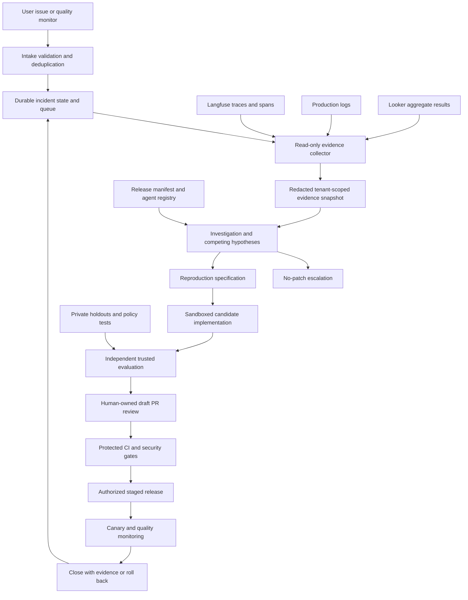

# Evidence-driven software factory for the multi-domain agent orchestrator

## Decision and intended outcome

Build an evidence-to-review pipeline, not an agent that changes production whenever a dashboard turns red. The factory should take a user issue or a conversation-quality decline, identify the responsible agent and skill, reproduce a bounded failure, propose a minimal repair, and submit independently evaluated evidence for human review. Production release remains a separate, authorized decision.

The initial domain is Ads-Agent: campaign creation and ROAS reporting. The architecture must also route issues to Reporting-Agent, the orchestrator, shared tools, data owners, and vendors without forcing every symptom into an Ads-Agent patch. A successful investigation can end in **no patch** with a useful escalation.

This document is a project design, not evidence of production performance. The local sample uses synthetic incidents and deterministic rules. Its scores are fixture inputs, not measured model quality. No speedup, accuracy improvement, production access, or autonomous general root-cause analysis is claimed.

## 1. Delivery boundary: prototype versus production

The local repository is the delivery artifact; the user will decide whether and where to push it. Implementation is evolving alongside these documents. Tests and actual generated reports—not this design—determine whether a particular checkout meets the prototype contract.

| Capability | Local prototype scope | Production requirement, not implemented by the prototype |
|---|---|---|
| Intake | Explicit synthetic JSON incident; deterministic offline processing | Authenticated issue/webhook intake; signed webhook verification; deduplication; durable queue |
| Evidence | Synthetic telemetry correlated by tenant, agent, skill, release, UTC window, and trace identity | Authorized, bounded collection; completeness checks; data governance; consistent snapshots |
| Optional integration surfaces | Explicit Langfuse trace-ID reads, precreated Looker Look aggregate results, local exported production-log JSONL; fake-transport tests, not live-access proof | Deployment-specific API validation, tenant enforcement, credential lifecycle, reliable collection, cloud-log API adapters |
| Ownership | Agent registry maps named agents/skills to permitted paths and owners | Registry validated against release provenance and authoritative code ownership |
| Diagnosis | Known, deterministic scenario rules | Competing hypotheses, uncertainty handling, expert approval for new defect classes |
| Repair | Candidate copy with a narrow path allowlist; predefined ROAS repair or campaign skill-contract repair | Sandboxed implementation workers; dependency and policy-aware changes |
| Evaluation | Trusted evaluator outside candidate tree reruns baseline and candidate; actual Python replay for ROAS; static skill contract for campaign confirmation | Private behavioral holdouts, real agent/tool simulation, adversarial evaluation, calibrated scoring |
| Outputs | JSON report, content hashes, patch, review text and PR body | Tamper-evident provenance, signed attestations, durable evidence store |
| Optional publication | Explicit opt-in draft publisher; default local/dry-run verification; verify bundle and intended upstream/main before remote action | Scoped GitHub App, environment approvals, organization policy and audit integration |
| Release | No automatic merge, deployment, campaign execution, or production mutation | Staged deployment, independent release approval, canary monitoring, tested rollback |
| Agent runtime | Role prompts/native skill assets can describe how Claude participates | Offline demo does not call Claude; prompts alone do not establish orchestration or behavioral safety |

Optional adapters are not an always-on production collector. An API request implementation and mocked tests do not establish that credentials, access scopes, vendor deployment compatibility, or tenant isolation work in the user's environment. The prototype's subprocess evaluator is **not a security sandbox**; use it only with the supplied trusted code and fixtures.

## 2. Target architecture

### Separation of responsibilities

* **Collector:** reads approved Langfuse projects, preapproved Looker results, and bounded log sources. It has no repository write, ad mutation, merge, or deployment permissions. It produces a redacted snapshot, never executable instructions.
* **Investigator:** uses the snapshot and release provenance to rank explanations. It cannot convert a trace message into a shell command or expand collection scope by itself.
* **Implementation worker:** sees minimal sanitized evidence, the reproduction specification, and an allowlisted source snapshot. It has no production credentials and no access to private evaluation expectations.
* **Evaluator:** owns trusted harnesses, negative cases, and holdouts outside the candidate tree. It compares immutable baseline and candidate identities and cannot be modified by the implementation worker.
* **Publisher:** consumes a verified bundle and explicit target authorization. Its authority ends at a draft PR. Production uses a separate installation identity from evidence collection.
* **Reviewer and release controller:** decide whether to merge and deploy. Independent deployment credentials and production gates prevent a draft publisher from becoming a release controller.

The workflow engine owns retries, budgets, leases, idempotency, and state. An LLM may assist hypothesis generation and repair, but cannot bypass transitions or mint an approval.

## 3. Traceability contract

Every investigation should carry a reproducible evidence envelope:

| Field group | Required meaning |
|---|---|
| Incident | Stable incident ID, intake source, severity, deduplication key, detection time, authorized scope |
| Identity | Tenant and user pseudonymous identifiers; access scope; environment; never infer tenant solely from free text |
| Execution | Conversation/session ID, trace ID, span ID, parent span ID, orchestrator run and turn ID, tool call ID |
| Release | Repository and commit, deployed release ID, agent registry version, agent configuration hash, skill and prompt hashes |
| Dependencies | Model identifier/version where available, model parameters, tool/API/schema versions, evaluator/rubric version |
| Time | UTC event and ingestion timestamps, inclusive/exclusive window semantics, source timezone and known skew |
| Measurement | Metric definition, numerator/denominator, cohort dimensions, sampling procedure, sample count, uncertainty |
| Evidence | Source and query identifiers, collection time, snapshot hash, redaction version, missing/truncated evidence markers |

Use keyed tenant/user pseudonyms with controlled key access; hashing predictable identifiers without a secret does not by itself protect identity. Store the reversible mapping, if required, outside worker access.

Join on strong identities first: authorized tenant + trace ID + release, then span/parent and tool call IDs. A timestamp coincidence is a correlation lead, not an identity join. Quarantine cross-tenant matches. Preserve both event and ingestion time for late telemetry; do not silently fill missing release IDs with the current branch. A release manifest must map deployed skills and code to the exact commit rather than assuming today's files caused yesterday's behavior.

The registry should map `(agent, skill)` to owner, repository, source and skill paths, runtime policy hooks, evaluator suites, escalation route, and permitted change classes. Missing mappings stop automatic repair. Reporting-Agent and Orchestrator entries illustrate routing beyond Ads-Agent; they do not imply implemented repairs for every agent.

## 4. Complete SDLC: from signal to verified release

### A. Detect and qualify

A user issue supplies expected versus observed behavior and a trace or conversation reference. A Looker decline supplies an aggregate cohort and metric window, not an instant root cause. Validate source authenticity, tenant scope, metric definition, evaluator version, sample sufficiency, and whether the decline survives cohort comparison. Deduplicate repeated alerts into one investigation while preserving individual evidence references.

### B. Collect and localize

Freeze the release and measurement context. Retrieve only approved explicit trace IDs initially; expand scope only with an authorized bounded query. Traverse Langfuse span parentage to determine which agent handled the turn and which skill and tool ran. Correlate production logs on tenant, trace, span/tool call, release, and UTC time. Use Looker for aggregate prevalence and cohort context rather than treating a dashboard row as a per-conversation trace.

If aggregate rows cannot identify affected traces, record that gap and obtain a governed drill-through or event mapping. Do not invent conversation IDs or retrieve an entire project as a fallback. Preserve pagination/completeness information and distinguish absent evidence from evidence that a failure did not occur.

### C. Investigate alternatives

For each hypothesis record supporting evidence, conflicting evidence, a discriminating test, owner, and confidence:

| Candidate cause | Discriminating checks | Likely disposition |
|---|---|---|
| Skill/prompt contract | Exact deployed skill hash; missing instruction; agent replay under fixed runtime | Skill change plus behavioral and runtime-policy tests |
| Application code | Deterministic replay with fixed input and expected result | Minimal code regression fix |
| Orchestrator | Parent span routing, wrong skill selection, lost context, handoff/version mismatch | Orchestrator owner investigation |
| Tool/schema or vendor | Request/response schema, status/timeout pattern, dependency version, unrelated cohorts | Adapter fix only if reproduced locally; otherwise vendor escalation |
| Input/data | Currency units, attribution delay, stale data, missing fields, schema drift | Data correction or validation contract |
| Evaluator/measurement | Rubric/model changes, sampling changes, missing labels, cohort mix | Measurement repair; do not rewrite working agent behavior |

Use distinct status labels: **observed** means a symptom is supported; **correlated** means a shared identity/time/release is established; **reproduced** means a controlled test fails for the stated contract; **verified** means the candidate passes an independently owned test that the same baseline fails. Verification always names its scope. A static document check is not verified real-world campaign safety. A verified replay is not a verified production rollout.

### D. Reproduce before repair

Construct a minimal sanitized replay, freeze relevant versions, and require baseline failure. Add boundary and negative cases rather than merely matching the reported example. If the baseline does not fail, the worker must not label the repair verified. Escalate as nondeterministic, incomplete evidence, or not reproduced, with the next experiment specified.

### E. Implement and review

Create an isolated candidate, constrain edits to the registry-authorized paths, and minimize change size. Keep policy, evaluator, CI permissions, and dependency manifests outside ordinary repair authority. Run trusted tests separately from worker-authored tests. Produce a bundle that identifies the evidence, baseline, candidate, changed paths, test outcomes, unresolved hypotheses, residual risk, and rollback plan. A hash checks identity, not the truth of the investigation.

The draft PR must state whether it fixes code, a static skill contract, or demonstrated agent behavior. A maintainer reviews the causal claim and functional change; a policy/security owner reviews high-impact mutation paths. Protected CI reruns relevant tests against the actual merge candidate, including integration and neighboring-agent regression coverage. Any new commit invalidates prior candidate-specific approval until reevaluated.

### F. Release and learn — proposed production capability

Release an immutable artifact tied to commit, skill/prompt/config hashes, model/tool versions, and evaluation report. Start in shadow or nonmutating mode, then an approved canary cohort, before staged expansion. Monitor task outcomes, errors, policy violations, latency, cost, and quality under an unchanged evaluator and comparable cohorts. Roll back the application and compatible skill/config bundle on guardrail breach; separately reconcile any external side effects. Close only after the agreed observation window and sufficient evidence, not merely after merge.

## 5. Three Ads-Agent investigations

### ROAS: executable unit mismatch

An issue reports implausibly small ROAS after a release; synthetic aggregate scores provide context. Trace and log evidence point to `Ads-Agent / roas_reporting`, and the registry identifies `examples/agents/ads/roas.py`. The controlled replay exercises spend expressed in currency micros. The baseline incorrectly treats micros as whole currency; the candidate normalizes the unit before computing the ratio. An evaluator outside the candidate tree runs both versions and checks the expected result and neighboring cases.

Production acceptance must cover zero spend (an explicit unavailable/undefined result, not fabricated infinity or zero), unsupported/negative inputs, consistent currencies or explicit FX conversion provenance, attribution/reporting window alignment, revenue basis, timezone, refunds, rounding and precision. A unit fix does not prove the source revenue is correct. Preserve the skill's reporting contract alongside the code behavior.

### Campaign creation: static contract defect, not behavioral proof

The campaign skill is missing an explicit confirmation requirement. The sample candidate updates `examples/agents/ads/skills/campaign_creation/SKILL.md` to require a preview and fresh explicit confirmation before mutation, reject silence or ambiguity, and honor cancellation. The sample test checks the **static contract text**. It does not call a model, demonstrate an actual conversation, or prove a tool call is blocked.

Production must enforce confirmation in code at the campaign mutation boundary. Bind a short-lived approval to the authenticated tenant/user, exact preview payload hash, operation and expiry; verify it server-side; invalidate it on any payload change; require authorization independently of confirmation; and use idempotency to prevent duplicate execution. A prompt is helpful guidance, not the security control. Behavioral tests should include changed budgets, unrelated prior consent, ambiguous replies, cancellation, replayed approvals, cross-tenant approvals, and retries.

### Upstream timeout: no speculative patch

A trace shows a tool timeout with corresponding production-log evidence. Without a reproducible local defect, changing a skill or increasing retries is not justified. The investigation should produce a dependency escalation with affected cohorts, release context, sanitized error metadata, retry history, and a proposed discriminating test. Campaign retries require special care: an ambiguous timeout may occur after a successful mutation. Never retry a write blindly; reconcile operation status and idempotency first. The offline timeout scenario must end in human escalation with no patch, not a manufactured green repair.

## 6. Quality measurement and release acceptance

Define quality as a set of measures, not one opaque score: task completion, grounded answer correctness, campaign-consent compliance, ROAS numeric accuracy, tool/error rate, latency and cost. Segment by tenant class, agent, skill, release, language, task difficulty, model/tool version, and evaluator version. Separate routing changes from within-skill regressions; aggregate declines can result from cohort mix.

Before alerting, predeclare a minimum sample policy and minimum meaningful effect for each measure using historical variance and operational risk. Show sample counts and confidence intervals, including the interval for the change. For repeated conversations, account for clustering rather than treating every turn as independent. Track missing labels and sampling coverage. Correct or budget repeated comparisons and sequential looks. Low-volume safety-critical violations can trigger immediate investigation even when a mean-quality test lacks power.

A changed evaluator requires a bridge study: score a fixed set with old and new versions, inspect disagreement, and keep trends separate until calibrated. Maintain a human-labeled validation set and a private holdout; protect against duplicate/leaked cases. Do not let a repair worker optimize directly against every hidden answer. Compare baseline and candidate on the same held-out cases, report effect size and uncertainty, and investigate regressions even if average quality improves.

Pilot economics must be measured: time to evidence, time to reproduction, reviewer effort, accepted-fix rate, false attribution, escaped defects, and incident recurrence. Compare like-for-like incident classes against a recorded baseline. Synthetic fixture scores establish none of these outcomes.

## 7. Four-phase rollout

1. **Local proof:** run synthetic scenarios, inspect candidate-only patches, confirm baseline-fail/candidate-pass for the executable ROAS regression, label campaign checks static, and confirm timeout escalation. No live credentials or remote writes. Exit: repeatable local evidence and explicit limitations.
2. **Read-only shadow investigations:** authorize bounded collector access and tenant handling; run beside human responders without code publication. Validate trace coverage, owner routing, diagnosis precision, data minimization, and cost budgets. Exit: owners approve observed evidence quality and operational controls.
3. **Human-approved draft repairs:** enable isolated workers and independent holdouts for narrowly approved change classes; install a scoped publisher; require maintainer/security review. Deployment stays manual. Exit: measured review utility, no policy bypass, and rehearsed incident/rollback procedures.
4. **Controlled release assistance:** add approved durable workflows, signed provenance, protected CI, staged canaries, and independent release/rollback controllers. Expand change classes only after evidence. Automatic merge or unconstrained self-modification is not an implied goal.

Detailed permissions and threat controls are in `THREAT_MODEL.md`; ownership, state transitions, retention and escalation are in `OPERATING_MODEL.md`.
